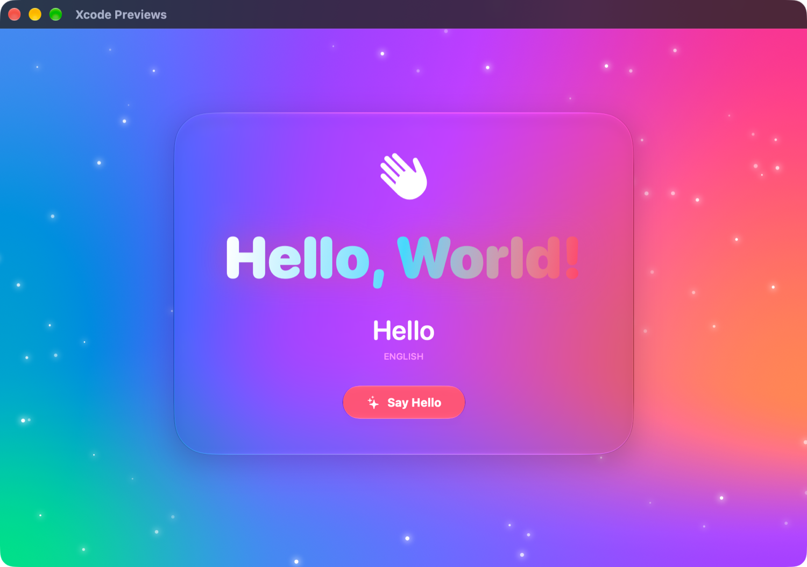

# HelloWorldMac ✨

My first Swift program: a native macOS "Hello, World!" app built with SwiftUI, made as fancy as I could.



## Features

| Feature | How it's built |
|---|---|
| Moving aurora background | `MeshGradient` whose inner points move over time, redrawn every frame by `TimelineView(.animation)`, with a slow `hueRotation` |
| Floating sparkles | ~90 glowing dots drawn in a `Canvas` with `.plusLighter` blending. They float up, sway and twinkle |
| Glass card | Liquid Glass material via `.glassEffect(.regular, in: .rect(cornerRadius: 40))` |
| 3D parallax tilt | `onContinuousHover` drives two `rotation3DEffect`s, so the card leans toward the pointer |
| Gradient title | Heavy rounded type with a `LinearGradient` fill and a glow from `.shadow` |
| Greetings in 12 languages | Switch every 2.5 s using `.id` + `.transition(.blurReplace)` |
| "Say Hello" button | `.buttonStyle(.glassProminent)`. The hand wiggles (`symbolEffect(.wiggle)`), a ring ripples out (`keyframeAnimator`) and the trackpad gives haptic feedback (`sensoryFeedback`) |
| Spring entrance | The card springs in from blurred and slightly smaller when the window opens |
| Clean window | `.windowStyle(.hiddenTitleBar)` and `.windowBackgroundDragBehavior(.enabled)` |

Press **Return** to say hello from the keyboard.

## Requirements

- macOS 27 or later
- Xcode 27 or later (to build from source)

## Download

Get `HelloWorldMac-v1.0.0-macOS.zip` from the [Releases](../../releases) page, unzip it and open `MyApp.app`.

The app is not notarized, so macOS Gatekeeper will block it the first time. To open it anyway, do one of these:

- Right-click `MyApp.app` → **Open** → **Open**, or
- Run `xattr -dr com.apple.quarantine MyApp.app` in Terminal.

## Build from source

```bash
git clone https://github.com/damon98xp/HelloWorldMac.git
cd HelloWorldMac
open "Untitled Project.xcodeproj"
```

Then press **⌘R** in Xcode. To build from the command line instead:

```bash
xcodebuild -scheme MyApp -configuration Release -derivedDataPath build build
open build/Build/Products/Release/MyApp.app
```

You may need to choose your own signing team under *Signing & Capabilities*.

## Project layout

```
MyApp/
├── MyApp.swift        # App entry point and window style
├── ContentView.swift  # The UI: card, aurora background, sparkles, ripple
└── Assets.xcassets
```

## License

[MIT](LICENSE)
